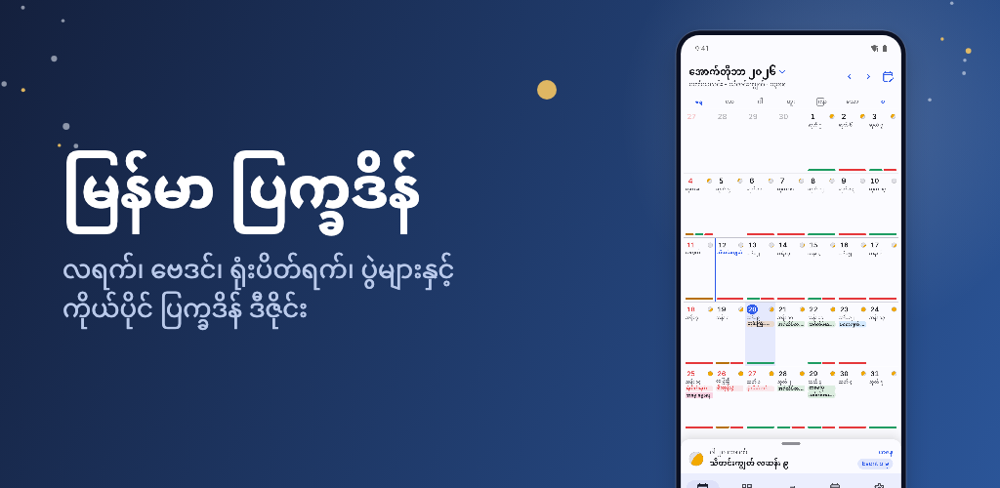
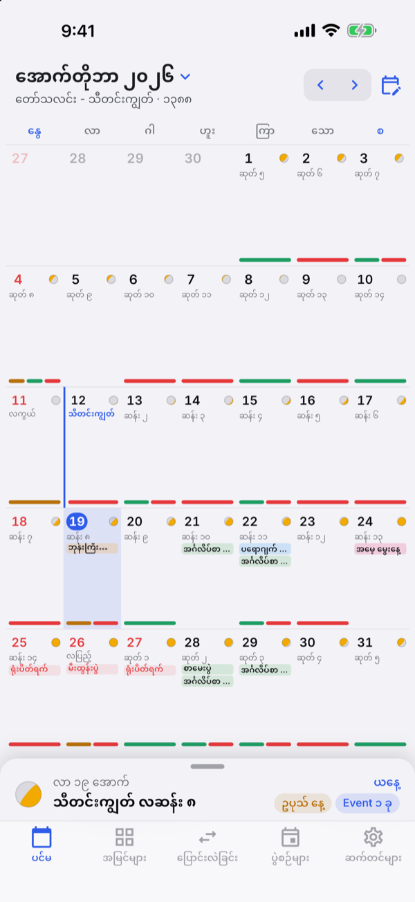
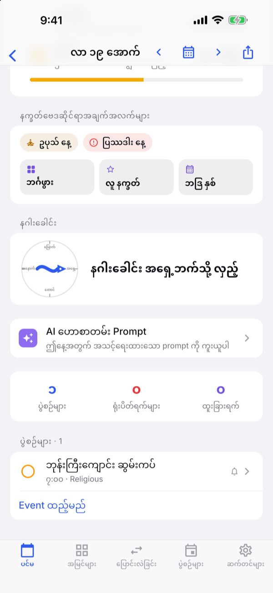
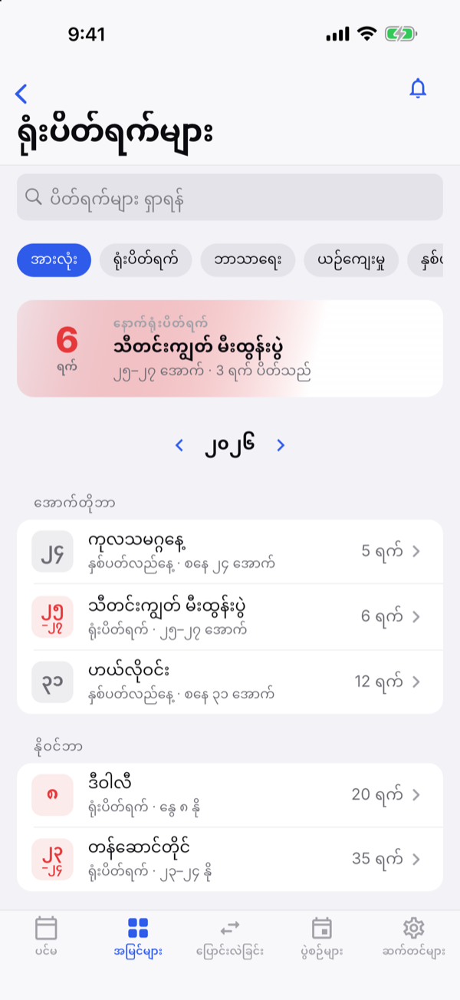
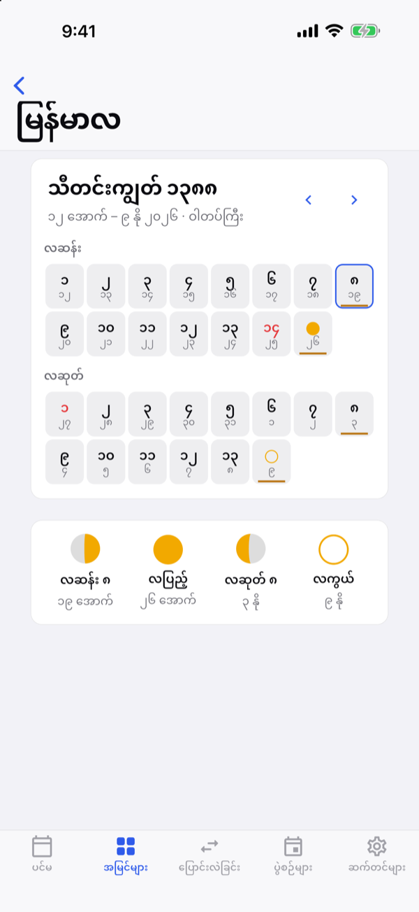
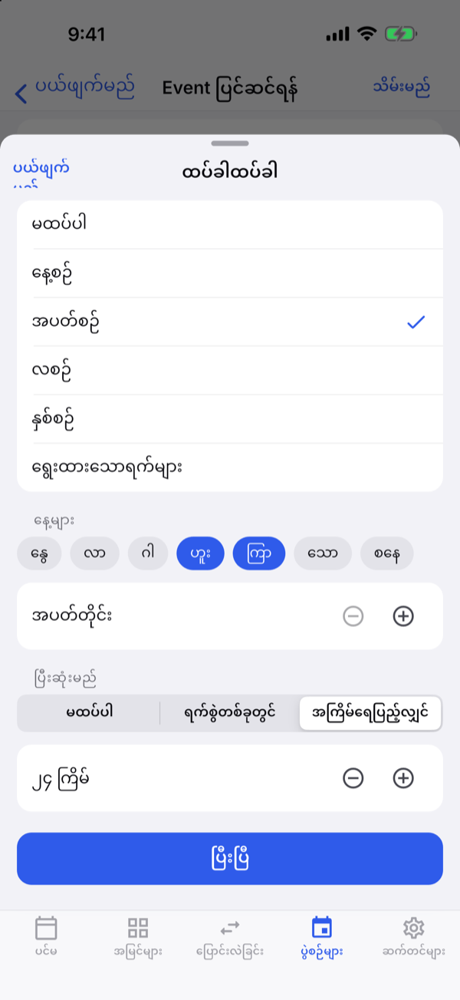
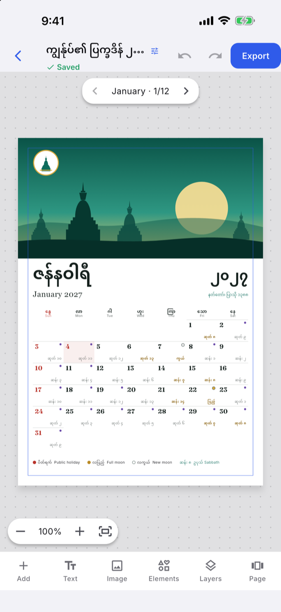
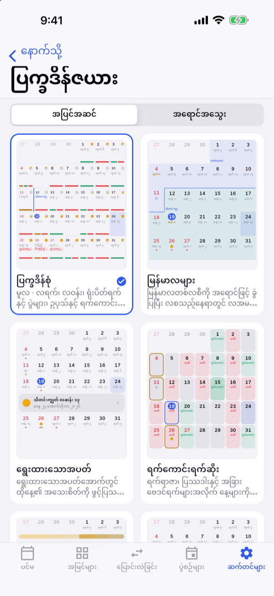
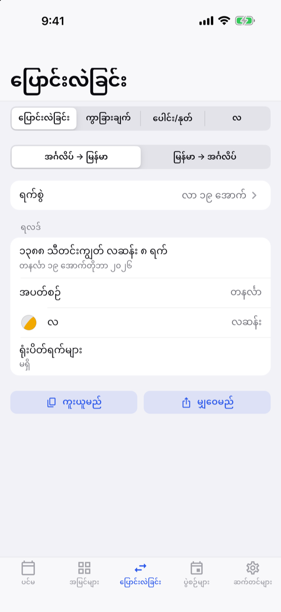

# 🗓️ Myanmar Calendar

<div align="center">



**The Myanmar calendar in your pocket: Myanmar and Western dates side by side, moon phases, astrology, holidays, events, and printable calendars you design yourself.**

[](https://play.google.com/store/apps/details?id=dev.mixin27.mmcalendar)
[](https://apps.apple.com/us/app/myanmar-calendar-pyatkadain/id6811349564)
[](https://flutter.dev/)
[](https://dart.dev/)
[](LICENSE)
[](https://flutter.dev/)

[Features](#-features) • [Screenshots](#-screenshots) • [Quick start](#-quick-start) • [Remote Config](#%EF%B8%8F-remote-config) • [Architecture](#%EF%B8%8F-architecture) • [Contributing](#-contributing)

</div>

---

## 📱 Overview

Myanmar Calendar shows every day in both calendars at once: the Western date, the Myanmar date and moon, Sabbath days, holidays and the traditional astrological days. Around that it adds what people actually plan with: events and class timetables, a holiday list with reminders, home-screen widgets, and **Calendar Studio** for designing a calendar to print or share.

The app's interface is in Myanmar and English; calendar data is available in six languages (Myanmar, English, Zawgyi, Mon, Shan and Karen). Calculations come from [`myanmar_calendar_dart`](https://pub.dev/packages/myanmar_calendar_dart), and several screens use the widgets from [`flutter_mmcalendar`](https://pub.dev/packages/flutter_mmcalendar).

---

## ✨ Features

### 🗓️ Home calendar

- Myanmar and Western dates in one month grid, with the moon, holidays, Sabbath and events on each day
- **22 grid layouts**, with **Almanac** as the default: lunar day, moon, holiday, events and a strip for Sabbath and good or careful days, and a marker where a Myanmar month begins
- Other layouts include Myanmar months (each month a tinted region), Focus week, Auspice (days tinted by their astrology), Moon band, Hero today and Week ribbons
- **12 grid themes** (Pagoda, Jade, Lacquer, Thadingyut, Thingyan and more) besides the app's own colours, each with its own palette, numerals and motif
- A day sheet with the Myanmar date, moon and badges; a month and year picker

### 🌙 Day details and astrology

- Myanmar date, Sasana year, Buddhist era and the Shan year
- Moon phase with a countdown to the next full moon, new moon and Sabbath
- Astrology said the way people say it: **ဥပုသ် နေ့**, **ရက်ရာဇာ**, **ပြဿဒါး နေ့**, **ဘင်္ဂဖွား**, **လူ နက္ခတ်**, **ဘဒြ နှစ်**
- A Nagahle compass showing which way the dragon's head turns
- An AI prompt for a horoscope, fortune-telling or divination reading, copied or shared; nothing is sent from the app

### 🏮 Holidays

- Every public, religious and cultural holiday, searchable and filterable
- Holiday details, and reminders before the days you care about
- Remote-config overrides for adding or disabling holidays without an app update

### 👀 Views

- Year, month, week and day
- **Myanmar month**: a Myanmar month laid out by its waxing and waning fortnights
- **Agenda**: the coming holidays, Sabbath days, moon days and your events

### 📌 Events

- **Weekly timetables**: pick several weekdays, every N weeks, and when it ends; each day can have its own time, and one save sets it all up with reminders
- **Multiple dates**: one event on any set of days, picked on the Myanmar calendar
- Daily, monthly and yearly repeats; change or skip a single occurrence
- Categories, priorities, locations, tags and reminders

### 🎨 Calendar Studio

- Design a wall, desk, social or story calendar from a gallery of presets
- Edit on the page: text, images, shapes, decorations, calendar grids and holiday legends
- Project themes that restyle every page; duplicate, reorder and delete pages; drag layers to reorder
- Export to **PDF, PNG, JPEG or ZIP**, every page at its own paper size or at a preset size, never stretched
- Save projects (`.mmcstudio`) and your own templates (`.mmctemplate`)

### 🔄 Converter

- Myanmar ↔ Western date conversion
- Date difference and date arithmetic
- Moon phase finder

### 📲 Widgets

- **iOS**: Today, Moon, Week, Countdown, Astrology day and Myanmar year widgets, plus lock-screen widgets
- **Android**: Jetpack Glance widgets in five styles
- Tapping a widget opens the matching page

### 🎛️ Personalisation

- Clear (iOS-like) and Material app styles, light and dark
- Theme presets, custom colours and alternate app icons
- App language and calendar language set separately; week start, time zone and display options
- Onboarding with quick setup, and a What's new sheet after each update

---

## 📸 Screenshots

<div align="center">

| Home | Day details | Holidays | Myanmar month |
| :---: | :---: | :---: | :---: |
|  |  |  |  |

| Class timetable | Calendar Studio | Grid layouts | Converter |
| :---: | :---: | :---: | :---: |
|  |  |  |  |

</div>

Store screenshots (captioned, at App Store and Google Play sizes) are in [`store/`](store/).

---

## 🚀 Quick start

### Prerequisites

- Flutter 3.x with Dart 3.11+
- Android Studio or VS Code with the Flutter tools
- Xcode for iOS builds (macOS)

### Run locally

```bash
git clone https://github.com/mixin27/mmcalendar.git
cd mmcalendar

# The repository is a Flutter workspace
flutter pub get

cd apps/myanmar_calendar
flutter run
```

### Run on the web

```bash
cd apps/myanmar_calendar
flutter run -d chrome
```

### Release builds

```bash
cd apps/myanmar_calendar

# Android
flutter build appbundle --release

# iOS (macOS only)
flutter build ipa --release

# Web
flutter build web --release
```

### Store screenshots

```bash
# Captures on dedicated simulators and emulators with demo data
scripts/capture_store_screens.sh            # iphone, ipad, android_phone, android_tablet

# Frames them with captions at store sizes, into store/
cd apps/myanmar_calendar && flutter test tool/store_frames_test.dart
```

### Native setup recovery

If the platform folders are regenerated and the icons or widgets are lost:

```bash
./scripts/restore_native_mobile_setup.sh --scope all
./scripts/verify_native_mobile_setup.sh --scope all
```

See [`docs/architecture/native_mobile_setup.md`](docs/architecture/native_mobile_setup.md). Alternate app icons are best checked on a real iPhone; the iOS Simulator can fail with LaunchServices errors (`NSPOSIXErrorDomain code=35`) even when the setup is right.

---

## ☁️ Remote Config

### Holiday overrides

- **Key**: `holidays_config_v2`
- **Type**: JSON string

```json
{
  "customHolidayRules": [
    {
      "id": "team_founding_day",
      "name": "Team Founding Day",
      "type": "other",
      "localizedNames": { "my": "အသင်းတည်ထောင်နေ့", "en": "Team Founding Day" },
      "rule": { "kind": "westernDate", "month": 9, "day": 1 },
      "cacheKey": "team_founding_day",
      "cacheVersion": 1
    },
    {
      "id": "thingyan_special",
      "name": "Thingyan Special",
      "type": "other",
      "rule": { "kind": "myanmarDate", "month": 1, "day": 1 }
    }
  ],
  "disabledHolidays": ["halloween"],
  "disabledHolidaysByYear": { "2027": ["valentinesDay"] },
  "disabledHolidaysByDate": { "2026-10-31": ["halloween"] }
}
```

Holiday IDs: [`holiday_id.dart`](https://github.com/mixin27/myanmar_calendar_dart/blob/main/lib/src/models/holiday_id.dart).

### App updates (optional)

`app_update_enabled` (bool), `app_update_latest_build_number` (int), `app_update_latest_version`, `app_update_min_supported_build_number` (int), `app_update_force_title`, `app_update_force_message`, `app_update_optional_title`, `app_update_optional_message`, `app_update_release_notes`, `app_update_android_url`, `app_update_ios_url`, `app_update_web_url` (strings).

---

## 🏗️ Architecture

A Flutter workspace: one app, feature packages, and shared and integration layers that features reach only through ports.

```text
mmcalendar/
├── apps/
│   └── myanmar_calendar/          # The app: routing, DI, native widgets
├── packages/
│   ├── features/
│   │   ├── calendar/              # Home grid, day sheet, day details
│   │   ├── views/                 # Year, week, day, Myanmar month, agenda
│   │   ├── holidays/              # Holiday catalog, page and reminders
│   │   ├── events/                # Events, repeats, timetables, reminders
│   │   ├── calendar_studio/       # Calendar design, print and export
│   │   ├── converter/
│   │   ├── home_widgets/          # Widget data and deep links
│   │   ├── onboarding/
│   │   ├── whats_new/
│   │   └── settings/
│   ├── shared/
│   │   ├── core/                  # Ports, constants, calendar runtime
│   │   ├── localizations/         # English and Myanmar strings
│   │   ├── ui_kit/                # Clear and Material components, tokens
│   │   ├── moon/                  # The real-sky moon glyph
│   │   └── motifs/                # Decorations for Studio and grid themes
│   └── integrations/
│       ├── database/              # Drift / SQLite
│       ├── firebase/              # Remote Config, Analytics, Crashlytics
│       ├── app_update/
│       └── telegram_web/
├── store/                         # Store screenshots and feature graphic
└── scripts/
```

### Stack

- Flutter and Dart, `flutter_bloc`, `go_router`, `drift`, `get_it` + `injectable`
- [`myanmar_calendar_dart`](https://pub.dev/packages/myanmar_calendar_dart) for the calendar engine and [`flutter_mmcalendar`](https://pub.dev/packages/flutter_mmcalendar) for calendar widgets
- WidgetKit (iOS) and Jetpack Glance (Android) for home-screen widgets
- Firebase Remote Config, Analytics and Crashlytics, only with the user's consent

---

## 🤝 Contributing

Contributions are welcome; see [CONTRIBUTING.md](CONTRIBUTING.md).

```bash
flutter pub get                                   # workspace dependencies
dart run build_runner build                       # code generation
flutter analyze                                   # static analysis
./scripts/test_all.sh                             # every package's tests
```

---

## 🔗 Related packages

- [`myanmar_calendar_dart`](https://pub.dev/packages/myanmar_calendar_dart): Myanmar calendar calculations, holidays, astrology and translations in pure Dart
- [`flutter_mmcalendar`](https://pub.dev/packages/flutter_mmcalendar): Myanmar calendar widgets for Flutter in Material 3, Cupertino and Liquid Glass

---

## 📝 License

MIT. See [LICENSE](LICENSE).

## 🙏 Acknowledgments

- Myanmar calendar calculations based on [Yan Naing Aye's algorithm](http://cool-emerald.blogspot.com/2013/06/algorithm-program-and-calculation-of.html)
- Traditional Myanmar astrology sources and community feedback
- The Flutter and open-source community

## 📞 Support

- Email: [kyawzayartun.contact@gmail.com](mailto:kyawzayartun.contact@gmail.com)
- Issues: [GitHub Issues](https://github.com/mixin27/mmcalendar/issues)

[](https://star-history.com/#mixin27/mmcalendar&Date)

<div align="center">

**Made for the Myanmar calendar community**

</div>
