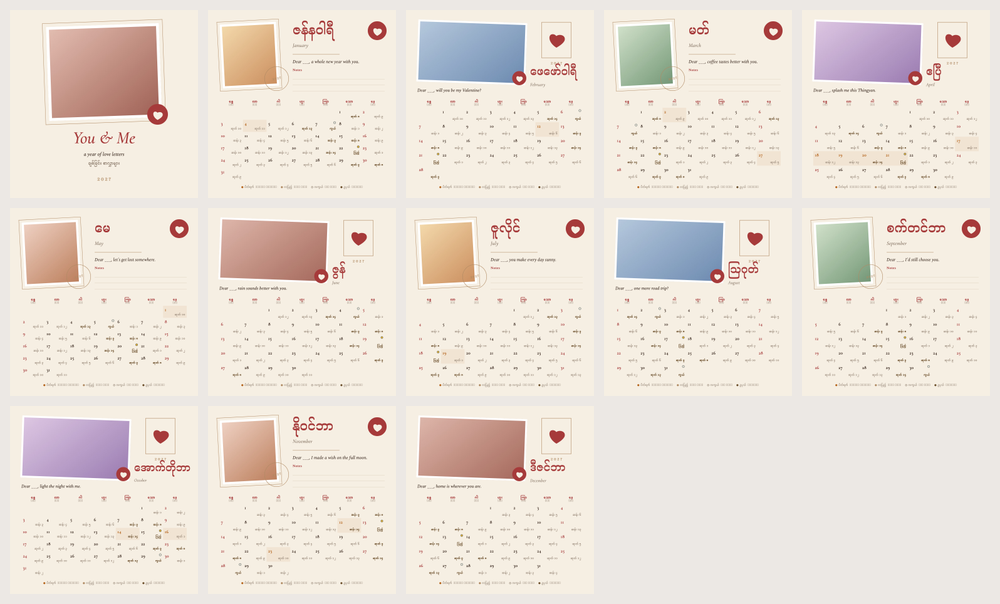
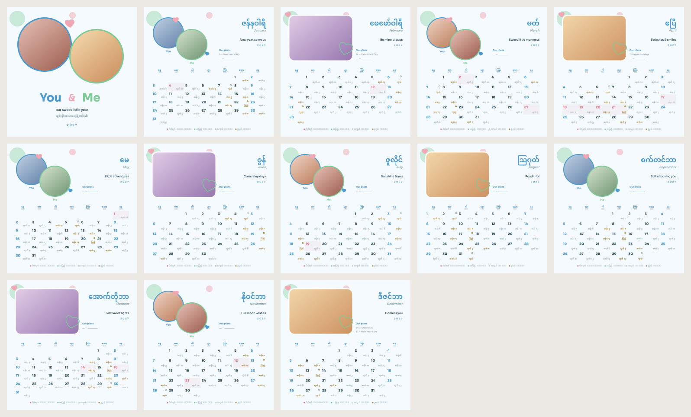
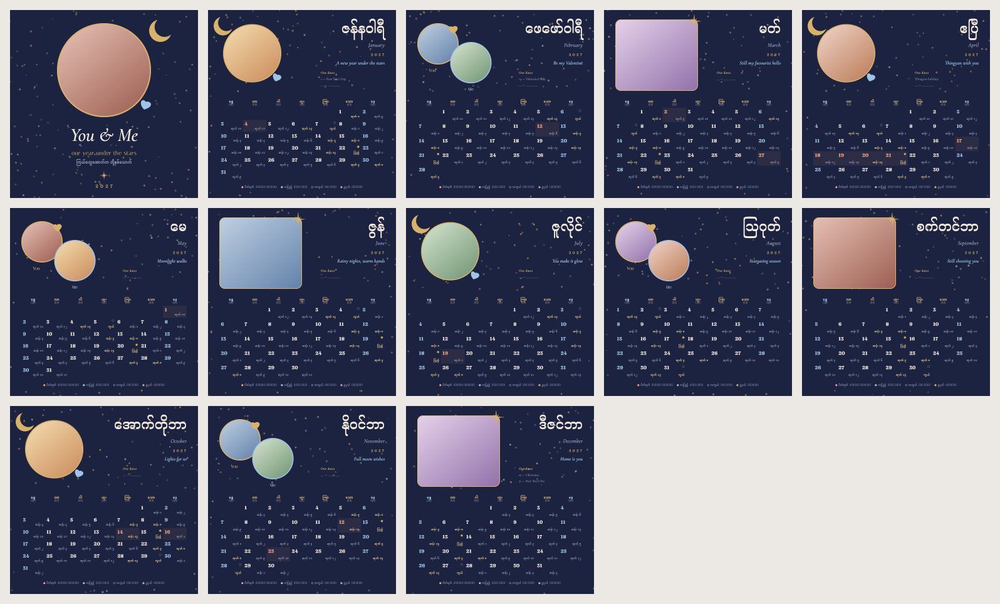
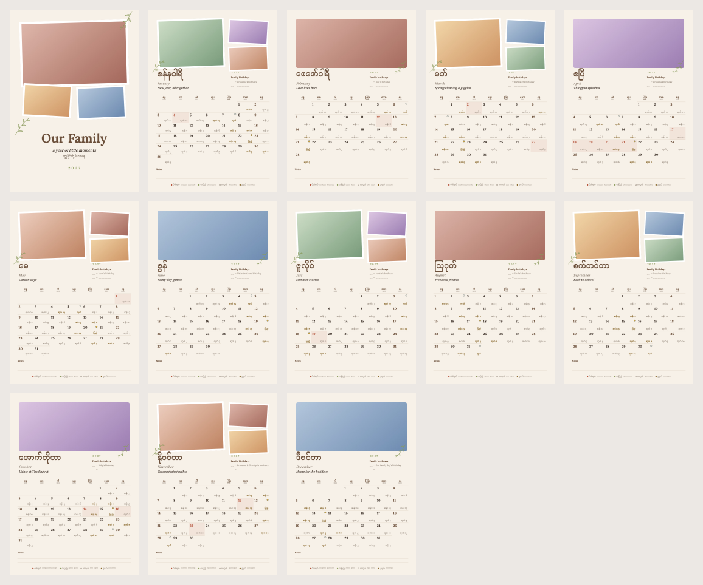
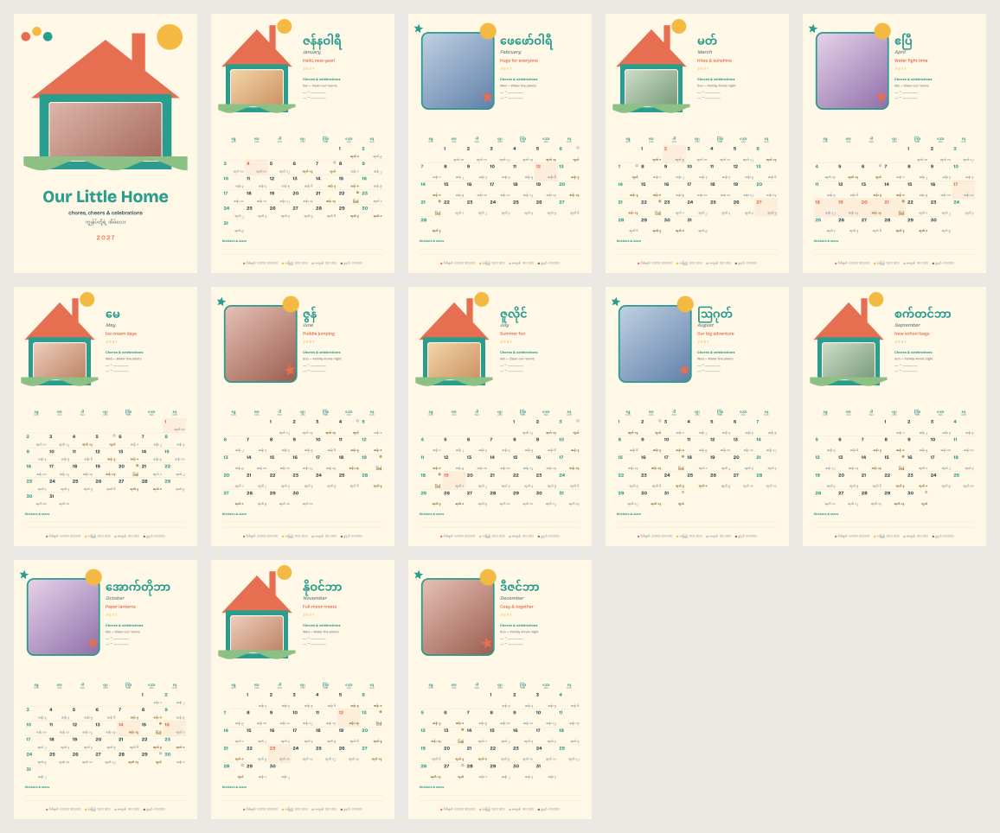
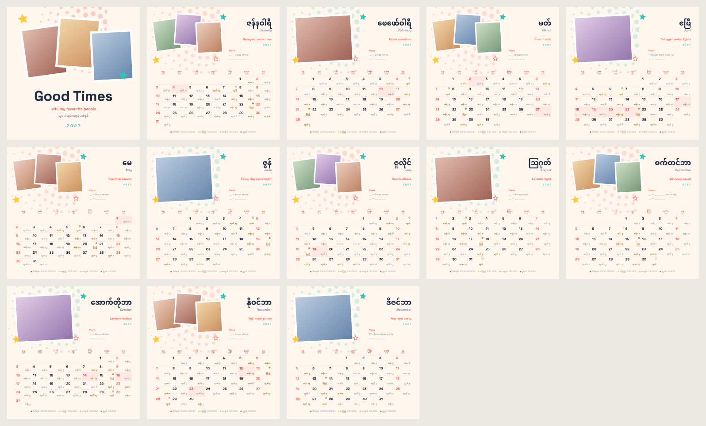
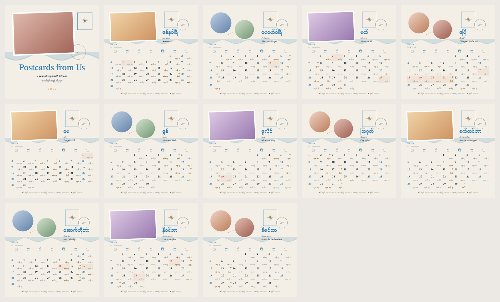
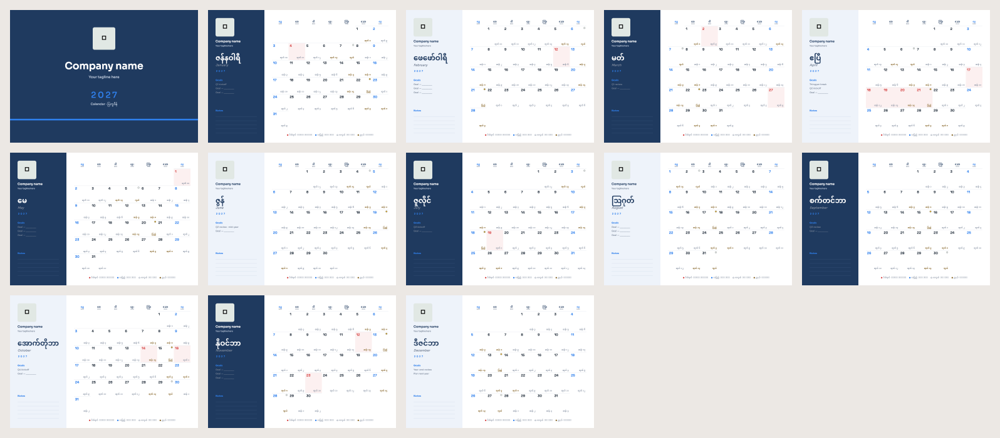
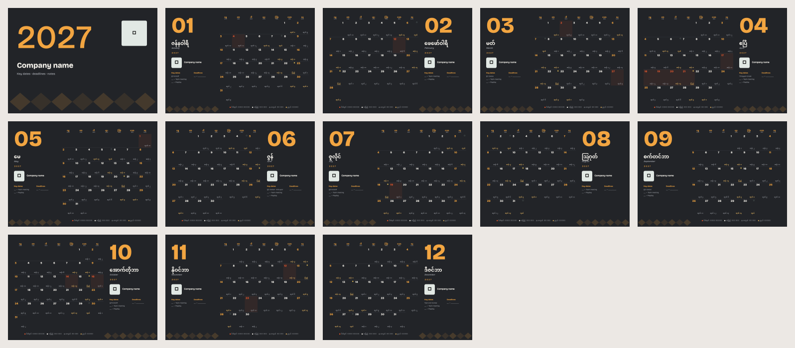

# Calendar Studio template pack

Ready-made Calendar Studio designs to share and import, in Myanmar and
English, with Myanmar dates, moon days and holidays in every grid. Photo
frames are empty: tap one, then **Replace**, to add your own. Text is
ordinary Studio text you can edit. Previews show soft colours where photos go.

Each design comes two ways:

- **`.mmcstudio`, a 2027 project**: a cover and twelve months, each month
  laid out a little differently. In the app: Calendar Studio → **Import
  project**.
- **`.mmctemplate`, a reusable template**: one month design that works for
  any year. In the app: Calendar Studio → **New calendar** → **Import
  template** (top bar). It's then listed under **My templates**: pick it and
  choose the year.

Studio won't export a project while a photo frame is empty; logo frames on
the business designs can stay empty.

## Relationship

### Love Letters

Cream paper and kraft, photos framed like postage stamps, a red wax seal and a "Dear ___," note to write each month.

square · moods: Love, Calm · [2027 project](relationship/love-letters-2027.mmcstudio) · [template (any year)](relationship/love-letters.mmctemplate)

### Sweet Pastel

Light blue and mint with a touch of pink: two round photos, floating hearts and soft dots. Playful and bright.

square · moods: Love, Playful, Bright · [2027 project](relationship/sweet-pastel-2027.mmcstudio) · [template (any year)](relationship/sweet-pastel.mmctemplate)

### Moonlit

Deep navy and gold: round "moon" photos with gold rings, a crescent and stars on every page. Dreamy and a bit dramatic.

square · moods: Love, Night, Dreamy · [2027 project](relationship/moonlit-2027.mmcstudio) · [template (any year)](relationship/moonlit.mmctemplate)

## Family

### Family Album

Warm linen and olive leaves: a three-photo collage, a family birthday list and a notes strip on every month.

A4 portrait · moods: Family, Warm, Calm · [2027 project](family/family-album-2027.mmcstudio) · [template (any year)](family/family-album.mmctemplate)

### Little Home

Sunny yellow and teal: a little house with a photo in the window, balloons, and a chores & celebrations list. Fun for kids.

A4 portrait · moods: Family, Playful, Bright · [2027 project](family/little-home-2027.mmcstudio) · [template (any year)](family/little-home.mmctemplate)

## Friendship

### Good Times

Coral, sunshine and teal: tilted polaroids, star stickers and a halftone burst, with a plans list for the crew.

square · moods: Friends, Playful, Bold · [2027 project](friendship/good-times-2027.mmcstudio) · [template (any year)](friendship/good-times.mmctemplate)

### Postcards

Sky blue and sand for friends who travel: postcard photos, stamps, a compass and a next-trip list.

square · moods: Friends, Travel, Calm · [2027 project](friendship/postcards-2027.mmcstudio) · [template (any year)](friendship/postcards.mmctemplate)

## Business

### Clean Corporate

White, navy and blue for the office desk: a side panel with your logo, monthly goals and notes, and a clean lined grid.

A4 landscape · moods: Business, Minimal, Calm · [2027 project](business/clean-corporate-2027.mmcstudio) · [template (any year)](business/clean-corporate.mmctemplate)

### Studio Bold

Charcoal and amber for studios and shops: a big month number, your logo, key dates and deadlines, and a subtle diamond weave.

A4 landscape · moods: Business, Bold, Night · [2027 project](business/studio-bold-2027.mmcstudio) · [template (any year)](business/studio-bold.mmctemplate)

## Regenerating

The files and previews come from
`packages/features/calendar_studio/tool/studio_templates/`. See its README to
build them for another year or add a design.
